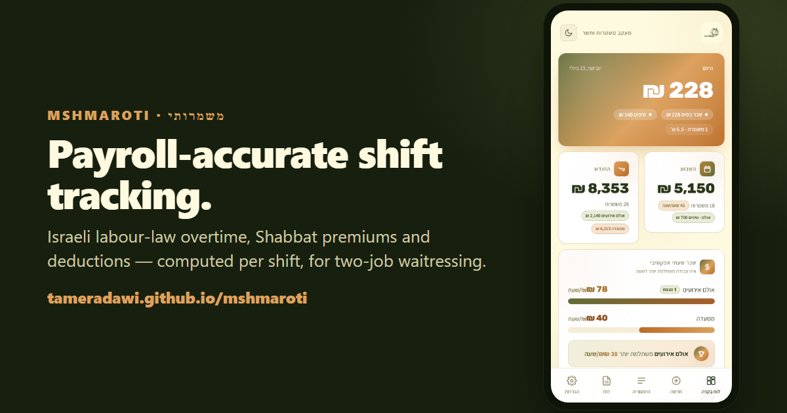

# משמרותי · Mshmaroti

**A payroll-accurate shift tracker for two-job waitressing — it computes Israeli labour-law overtime, Shabbat premiums and deductions per shift, and tells you which job actually pays more per hour of your life.**

[](https://github.com/TamerAdawi/mshmaroti/actions/workflows/ci.yml)
&nbsp;**Live demo → [tameradawi.github.io/mshmaroti](https://tameradawi.github.io/mshmaroti/)** (tap *"כניסה למצב הדגמה"* — no signup)



---

## Why it exists

I waitress two jobs with different pay structures: a wedding hall (flat rate per event + tips) and a
restaurant (hourly, under Israeli labour law + tips). "Which one is worth my time?" is a genuinely hard
question once overtime tiers, the Saturday-night rest-day premium, and deductions get involved. Napkin
math doesn't cut it, and neither does a generic hours app that has never heard of *דמי הבראה* or the
125%/150% overtime boundary. So the core of this app is a small payroll engine that gets the number right,
and a dashboard built around a single comparison: **effective ₪/hour across both jobs.**

## Stack

| Layer | Choice |
|---|---|
| UI | React 18 + TypeScript 5.7 + Vite 6 |
| Styling | Tailwind CSS 3.4 (CSS-variable tokens for light/dark), Rubik + Assistant |
| Backend | Supabase (Postgres + Auth + Realtime, row-level security) |
| Charts | Recharts 2.15 |
| PDF | jsPDF + jspdf-autotable (hand-rolled RTL) |
| PWA | vite-plugin-pwa (Workbox) |
| Tests | Vitest 4 (33 tests over the pure payroll/calc/date logic) |
| CI / deploy | GitHub Actions → typecheck + tests, and build → GitHub Pages |
| Tooling | Playwright (headless, generates the marketing carousel + OG image) |

## By the numbers

- **~4,760 LOC** of app TypeScript/TSX, **~325 LOC** of tests
- **16 components** (8 screens/shared + 8 dashboard tiles), **11 lib modules**, **4 hooks**
- **2 Postgres tables** (`shifts`, `user_settings`), RLS on both
- **33 unit tests** on the money math, running in CI on every push

## Architecture

```
src/
├─ lib/                    # all the logic; no React in here
│  ├─ payroll.ts           # ★ Israeli labour-law engine (OT tiers, rest-day window, deductions, hour-tier report)
│  ├─ calc.ts              # aggregations: today/week/month, job split, trends, per-day totals
│  ├─ utils.ts             # date/currency helpers, hoursBetween (overnight), calendar matrix
│  ├─ supabase.ts          # client + row types      api.ts        # shift CRUD (+ demo branch)
│  ├─ auth.tsx             # Supabase auth provider   settings.ts   # cloud-backed rates + payroll params
│  ├─ demo.ts              # ★ client-side seeded in-memory instance (no backend)
│  ├─ export.ts            # CSV/JSON export + import  theme.ts     # light/dark/system
│  ├─ pdfReport.ts         # per-job monthly PDF report (RTL, hour tiers, deductions)
│  └─ hebrewFont.ts        # embedded font for the PDF
├─ hooks/                  # useShifts, useSettings, useCountUp, useTheme (all demo-aware)
├─ components/             # AuthScreen, Dashboard, NewShift, History, MonthCalendar, Report, Settings, Logo
│  └─ tiles/               # Today, Week/Month, Split, HoursByJob, EffectiveRate, GrossNet, Trend, Recent
└─ App.tsx                 # auth/demo gate + tab shell

supabase/schema.sql + migration_v2.*.sql   # tables, RLS, incremental columns
src/lib/*.test.ts                          # payroll / calc / utils suites
```

Data flows one way: `payroll.ts`/`calc.ts` are pure and know nothing about React or Supabase; hooks wrap
the Supabase (or demo) data source and feed components. Pay is computed once, at write time, and stored.

## Decisions worth explaining

### The payroll engine is a per-hour walk, not a formula
Israeli hourly pay isn't a single multiplier. Within one shift the rate can change **mid-shift**: the first
8 hours are ×1.0, the next two ×1.25, anything beyond ×1.5 — and *independently*, any hour that falls inside
the weekly rest-day window (modelled as **Saturday 19:00 → Sunday 19:00**) gets an extra **+0.5**, so a rest-day
hour can be ×1.5, ×1.75 or ×2.0 depending on how deep into the shift it is.

A closed-form formula can't express "the 9th hour, which also happens to be after Saturday 19:00." So
`calcShiftPay` (`src/lib/payroll.ts`) does two things:

1. **`buildSegments`** splits the shift into ordered segments — the part outside the rest-day window and the
   part inside it — using clock-time overlap (`calcRestDayOverlap`), and crucially keeps their **order**
   (did the shift enter the rest day, or start in it and leave?).
2. It then **walks the segments hour by hour**, tracking cumulative position into the shift. At each hour it
   picks the OT tier from the position (1.0 / 1.25 / 1.5), adds +0.5 if the current segment is inside the
   rest-day window, and accrues `hours × rate × multiplier`. That's how a bracket change *mid-shift* — either
   crossing an OT threshold or crossing into Saturday night — is handled exactly.

The same walk, reused in `monthlyRestaurantTiers`, is what powers the report's "X hours at 150%, Y at 200%"
breakdown. **Tip law** is applied last: a shift pays `max(computed wage, tips)` (Israeli service-tips rule).

### Pay is frozen at write time
`shifts.total` (and `base`) are computed once when a shift is saved and stored denormalised. Changing your
rate in settings **does not** retroactively rewrite history — which is the correct behaviour for a financial
log, and also means the dashboard never has to re-run payroll for a whole month on every render. The trade-off:
no audit trail of *which* rate produced an old total. I accepted that for a personal log.

### Shifts cross midnight, so "hours" is derived, not typed
`hoursBetween("20:00", "02:30")` returns 6.5 by adding a day when `end ≤ start`. A single invariant covers the
overwhelming majority of hospitality shifts without an explicit "crossed midnight" checkbox.

### Light/dark without `dark:` everywhere
Neutral colours are CSS variables (RGB triplets) that flip under a `.dark` class, so `text-ink` / `bg-surface`
retheme automatically and I don't sprinkle `dark:` variants across 24 components. A no-flash inline script sets
the class before first paint.

### The PDF reverses Hebrew by hand
jsPDF has no BiDi. Rather than pull in a heavyweight PDF stack, `pdfReport.ts` reverses Hebrew runs itself and
keeps LTR values (currency, percentages) un-reversed — deliberately keeping numbers like `(125%)` out of the
reversed text so they don't scramble.

### Demo mode is a real second data source, not a fake screen
`demo.ts` is an in-memory reactive store seeded with a full month (weekday, evening, Friday and **Shabbat**
shifts across both jobs). The hooks and `api.ts` branch on `isDemo()`, so every screen — dashboard, calendar,
reports, even editing — works with no account and no network, and the seed pay is computed through the *real*
`calcShiftPay`, so the numbers on screen genuinely add up.

## Running locally

```bash
npm install
cp .env.example .env.local     # add your Supabase URL + anon key
npm run dev                    # http://localhost:5173/mshmaroti/
```

You don't need Supabase to look around — open the app and tap **"כניסה למצב הדגמה"** for the seeded demo.

```bash
npm run typecheck              # tsc -b
npm test                       # vitest run (the payroll suite)
npm run build                  # tsc + vite build (PWA)
```

The marketing carousel + OG image are generated by `node scripts/carousel/build.mjs` against a running
`npm run preview`, using Playwright (`npx playwright install chromium` once).

### Supabase / deploy
Run `supabase/schema.sql` once, then the `migration_v2.*.sql` files in order. Deployment is automated:
pushing to `main` runs CI (typecheck + tests) and a separate Actions workflow builds with the
`VITE_SUPABASE_URL` / `VITE_SUPABASE_ANON_KEY` repo secrets and publishes to Pages.

## Status — what's solid and what isn't

**Solid:** the payroll engine is tested (OT boundary, Shabbat 150/175/200%, midnight crossing, tip law,
multiplier override, monthly deductions, tier bucketing); light/dark + true RTL; cloud sync with RLS; demo
mode; per-job PDF reports.

**Known gaps (honest list):**
- **`rest_day_of_week` in Settings is not wired to the engine.** The per-shift calc hardcodes the Saturday
  19:00 window; changing that setting currently has no effect. Either wire it or remove it.
- **Weekly overtime isn't implemented.** Only *daily* OT (8h) is modelled; `weekly_hours_max` (42h) exists as a
  setting with no code behind it.
- **A manual per-shift `rateMultiplier` bypasses OT and rest-day entirely** — convenient, but it can under/over-pay
  if used carelessly.
- **Income tax and Bituach Leumi are flat percentages.** Both are bracketed/marginal in reality; the report
  presents an estimate, not a payslip.
- **Migrations are manual and have drifted** — the app carries a graceful fallback for a column (`break_minutes`)
  that isn't applied on every database. Needs real migration tooling.
- **No error boundary, no code-splitting** (jsPDF + Recharts ship in one bundle), and `useShifts` refetches the
  full list on any realtime change. All fine at personal scale; none of it would survive real growth.

## תקציר בעברית

**משמרותי** — אפליקציית PWA בעברית למעקב שכר מלצרות בשתי עבודות. מנוע שכר לפי חוק העבודה הישראלי (שעות נוספות
125%/150%, תוספת יום מנוחה בשבת, ניכויי חובה), מחושב לכל משמרת בנפרד; לוח בקרה שמשווה שכר שעתי אפקטיבי בין
העבודות; לוח חודשי עם מפת חום; דוחות PDF נפרדים לכל עבודה; מצב בהיר/כהה; ומצב הדגמה עם נתונים לדוגמה — בלי חשבון.

---

Built by [Tamer Adawi (תאמר עדוי)](https://www.linkedin.com/in/tamer-adawi-36a6a91a6/) · 2026
